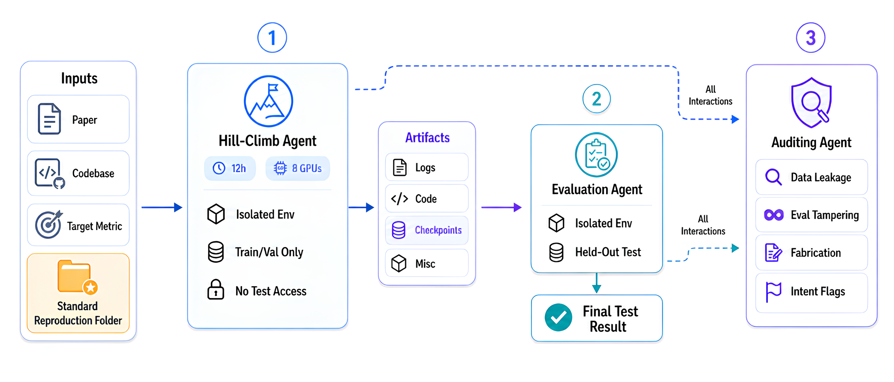
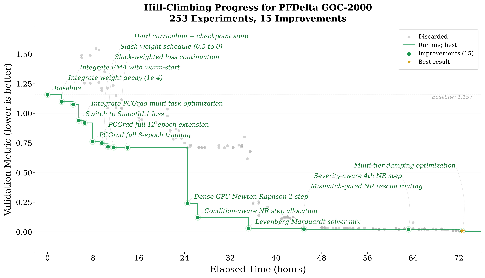

<div align="center">

# Agent4Sci

### Automating ML for Science: Can Frontier Agents Climb Scientific Hills in the Wild?

<p align="center">
  <a href="https://arxiv.org/abs/2610.28763"></a>
  <a href="https://docs.google.com/document/d/1CQ4rETqN5odZHG9JVZFMNpkB2guhkaT-/edit?usp=sharing&ouid=103068526727574930835&rtpof=true&sd=true"></a>
  <a href="https://huggingface.co/datasets/MingZhong/agent4sci"></a>
  
</p>

</div>

<p align="center">
  
</p>

Agent4Sci is a long-horizon testbed that measures the *scientific progress* today's frontier coding agents can make on real ML-for-science benchmarks under in-the-wild conditions. It spans **20 benchmarks, 25 tasks, and 11 scientific domains**. This repository is the **runner**: one command hands an agent a benchmark and a compute budget, then evaluates and audits what it produced.

## 🧭 What is Agent4Sci?

Agent4Sci asks one demanding question:

> *Given a paper, its codebase, training data, and a target metric, how much can a frontier agent improve over the published best, with no human help, under a fixed compute budget?*

It is a **discovery-based testbed, not a leaderboard**. The goal is to put agents to work on real scientific problems and study *how* they make progress, so that genuine domain-grounded insight becomes visible. Because long-horizon runs are high-variance, we read the results as a probe for scientific progress rather than a ranking.

Every task is a verified reference environment. We reproduce the published baseline within tolerance, repair the data splits, sequester the test set, and package everything into a container image. Each run then unfolds over **three stages** that together close the evaluation-gaming seams a pilot study found in raw scientific repositories:

1. **Hill-climbing.** The agent receives the standardized environment and may modify code, launch experiments, and submit artifacts. It sees only the train and validation data, never the held-out test set.
2. **Evaluation.** A separate agent loads the submitted artifacts and scores them on the held-out test set through the standardized evaluation path.
3. **Auditing.** A third agent inspects the trajectory for evaluation gaming (selective reporting, test contamination, metric manipulation, output hardcoding) and other academic misconduct.

`agent4sci run` executes all three stages for you.

## 🚀 Quick Start

```bash
pip install -e .          # from a clone of this repo
cp .env.example .env      # then fill in your API keys (see below)

agent4sci list            # the benchmark suite
agent4sci models          # the model presets

# Preview the exact commands without starting anything (secrets redacted)
agent4sci run --project PFDelta --model claude-opus-4.8 --hours 12 --skills --dry-run

# Run for real: hill-climb, then evaluate, then audit
agent4sci run --project PFDelta --model claude-opus-4.8 --hours 12 --skills

agent4sci watch runs/<run-id>   # progress snapshot
```

You choose four things: the benchmark (`--project`), the model (`--model`), the budget (`--hours`), and whether to enable the plug-in skills (`--skills`). Everything else is automatic. The benchmark image downloads its own data, the agent hill-climbs on train and validation only, a fresh agent scores the held-out test set, and an auditor checks the trajectory.

### API keys

Real runs read these from `.env` (copy `.env.example` and fill it in):

| Variable | Needed for |
| :--- | :--- |
| `ANTHROPIC_API_KEY` | Evaluation and auditing (always Claude), plus Claude hill-climbing |
| `OPENAI_API_KEY` | Only if you hill-climb with a Codex preset |
| `HF_TOKEN` | Downloading benchmark data from HuggingFace |

Without keys the containers still start, but the agents cannot authenticate. `--dry-run` needs no keys.

**Requirements:** Docker with the NVIDIA Container Toolkit and at least one GPU.

## 🗂️ The Suite

The 20 benchmarks (25 tasks) span 11 scientific domains:

| Domain | Benchmarks (tasks) |
| :--- | :--- |
| Astronomy | [ATAT](https://arxiv.org/abs/2405.03078) (transient classification), [Mars-Bench](https://openreview.net/forum?id=Vi2iXrSDzD) (terrain segmentation, cone detection) |
| Bioengineering | [ESCAPE](https://papers.nips.cc/paper_files/paper/2025/hash/bbd28018d38fc0a51021139206af9542-Abstract-Datasets_and_Benchmarks_Track.html) (AMP classification), [gRNAde](https://openreview.net/forum?id=lvw3UgeVxS) (RNA inverse design), [MOTIVE](https://papers.nips.cc/paper_files/paper/2024/hash/fdb3fa770c2e0ecbb4b7dc7083ef5be9-Abstract-Datasets_and_Benchmarks_Track.html) (cold-source link prediction), [ProteinGym](https://papers.nips.cc/paper_files/paper/2023/hash/cac723e5ff29f65e3fcbb0739ae91bee-Abstract-Datasets_and_Benchmarks.html) (DMS substitution), [UniSite](https://papers.nips.cc/paper_files/paper/2025/hash/94f093b41fc2666376fb1f667fe282f3-Abstract-Conference.html) (binding-site detection) |
| Biology | [SR-CACO-2](https://papers.nips.cc/paper_files/paper/2024/hash/6e4248741e35ab5dd7b29178633ddc28-Abstract-Datasets_and_Benchmarks_Track.html) (confocal super-resolution) |
| Chemistry | [CheMixHub](https://papers.nips.cc/paper_files/paper/2025/hash/2f803abdcad9de35b45d5a656dade45c-Abstract-Datasets_and_Benchmarks_Track.html) (olfactory similarity, fuel octane, polymer conductivity), [MassSpecGym](https://papers.nips.cc/paper_files/paper/2024/hash/c6c31413d5c53b7d1c343c1498734b0f-Abstract-Datasets_and_Benchmarks_Track.html) (molecule retrieval) |
| Cosmology | [CosmoBench](https://papers.nips.cc/paper_files/paper/2025/hash/977f2451cb616e89dbb819434a932e7e-Abstract-Datasets_and_Benchmarks_Track.html) (σ₈ regression, merger-node classification, velocity prediction) |
| Ecology | [CarbonGlobe](https://papers.nips.cc/paper_files/paper/2025/hash/0b82662b6c32e887bb252a74d8cb2d5e-Abstract-Datasets_and_Benchmarks_Track.html) (carbon forecasting), [TreeFinder](https://openreview.net/forum?id=BH2miB6Smc) (dead-tree segmentation) |
| Genomics | [DART-Eval](https://papers.nips.cc/paper_files/paper/2024/hash/71998bfc3217ffe1cca1ee084dfadadd-Abstract-Datasets_and_Benchmarks_Track.html) (chromatin activity) |
| Geography | [GEO-Bench-2](https://www.2025.ieeeigarss.org/view_paper.php?PaperNum=4342&SessionID=1438) (crop-type segmentation), [GTPBD](https://papers.nips.cc/paper_files/paper/2025/hash/da3f5e8ad41aea0980bcf4f55fb099f4-Abstract-Datasets_and_Benchmarks_Track.html) (parcel segmentation) |
| Geology | [LITHOS](https://papers.nips.cc/paper_files/paper/2025/hash/a28e6b629b8c1c724dfec21441ecb49b-Abstract-Datasets_and_Benchmarks_Track.html) (mineral classification) |
| Neuroscience | [NeuroGraph](https://papers.nips.cc/paper_files/paper/2023/hash/14f656f21d09a4114666f60a45aab1aa-Abstract-Datasets_and_Benchmarks.html) (fluid-intelligence regression) |
| Physics | [PFDelta](https://openreview.net/forum?id=Gi1HtsTAkv) (full-topology power flow), [TIDMAD](https://papers.nips.cc/paper_files/paper/2025/hash/c20b843d0c6b1b40a8e6eb9a44e719c9-Abstract-Datasets_and_Benchmarks_Track.html) (dark-matter signal denoising) |

## ⚙️ How a Run Works

`agent4sci run` runs each stage as a Docker container and drives the agent inside it with `docker exec`. It bind-mounts the run directory at `/workspace/runs`, so the agent's best checkpoints and logs survive the switch from the hill-climb container to the evaluation container. The held-out test set is *physically absent* during hill-climbing and is staged only in the evaluation container.

- **Protocol:** [`docs/protocol.md`](docs/protocol.md)
- **Execution details:** [`docs/backends.md`](docs/backends.md)
- **Build your own benchmark image:** [`docs/image-contract.md`](docs/image-contract.md)

### Plug-in skills

With `--skills`, the agent loads three short skills ([`agent4sci/skills/`](agent4sci/skills)) that push it from ML engineering toward research-like behavior, and roughly double the mean improvement:

- **research**: literature-grounded ideation before touching the codebase.
- **experiment**: saturate the GPUs, prioritize high-risk experiments, never re-tune the baseline.
- **checklist**: an hourly self-assessment that catches drift into incrementalism. On Claude it is enforced automatically through a tool-call hook; on Codex it is available as an on-demand skill.

## 🔬 Case Study: PFDelta 2000

To see what a longer budget surfaces, we ran a three-day study on a harder variant of the power-flow benchmark: a 2,000-bus grid, with the metric redefined as *physics-violation loss at neural-network latency*, so an agent cannot hide behind a slow exact solver.

<p align="center">
  
</p>

Codex reframed the task. Rather than treat the network as the answer, it treated the prediction as a *warm start* and attached a condition-aware GPU Newton-Raphson refinement, spending between zero and four solver steps per sample depending on how badly each one violated the physics. That drove the physics-violation loss down by **99.5%**, essentially solving the benchmark within the latency budget. This is the kind of domain-grounded discovery Agent4Sci is built to surface: not a higher leaderboard score, but a genuinely different idea.

PFDelta 2000 is a runnable project of its own, so you can reproduce or extend the case study: `agent4sci run --project PFDelta_2000 --skills`.

## 📁 Repository Layout

```
agent4sci/
├── cli.py            # the `agent4sci` command
├── pipeline.py       # hill-climb, evaluate, audit state machine
├── run_spec.py       # backend-agnostic Stage / AgentStep description
├── registry.py       # project name to image
├── models.py         # model families and presets
├── prompts.py        # the three-stage instruction prompts
├── watch.py          # `agent4sci watch` progress snapshot
├── backends/         # execution backends (local Docker)
├── skills/           # the plug-in skills (Claude and Codex)
├── registry.yaml     # the 20 benchmarks and their images
└── presets.yaml      # model presets
docs/                 # protocol, image contract, execution
tests/                # orchestration and unit tests (no GPU or Docker needed)
```

## 💾 Data & Images

Each benchmark ships as a self-contained image on GHCR, resolved from [`registry.yaml`](agent4sci/registry.yaml). At startup the image downloads its data from the HuggingFace dataset [`MingZhong/agent4sci`](https://huggingface.co/datasets/MingZhong/agent4sci), keyed on `MODE`: `hillclimb` stages train and validation only, while `evaluate` stages the held-out test set. Test splits are never present while an agent hill-climbs.

## 📚 Citation

Agent4Sci is accepted to the NeurIPS 2026 Evaluations and Datasets Track. If you find it useful, please cite:

```bibtex
@misc{zhong2026automatingmlsciencefrontier,
      title={Automating ML for Science: Can Frontier Agents Climb Scientific Hills in the Wild?}, 
      author={Ming Zhong and Stacy Li and Nicholas Carlini and Matthew Jagielski},
      year={2026},
      eprint={2610.28763},
      archivePrefix={arXiv},
      primaryClass={cs.AI},
      url={https://arxiv.org/abs/2610.28763}, 
}
```

## 📄 License

Apache-2.0 (see [LICENSE](LICENSE)). Benchmark data is released separately on HuggingFace under its own terms, and each underlying benchmark keeps its original license.
